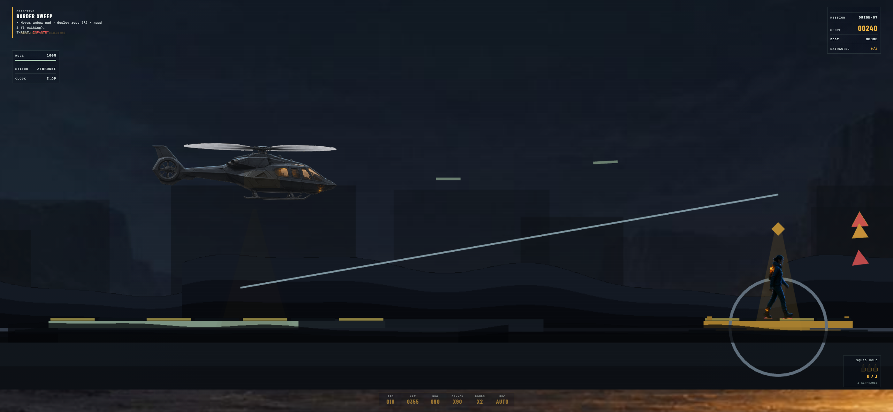
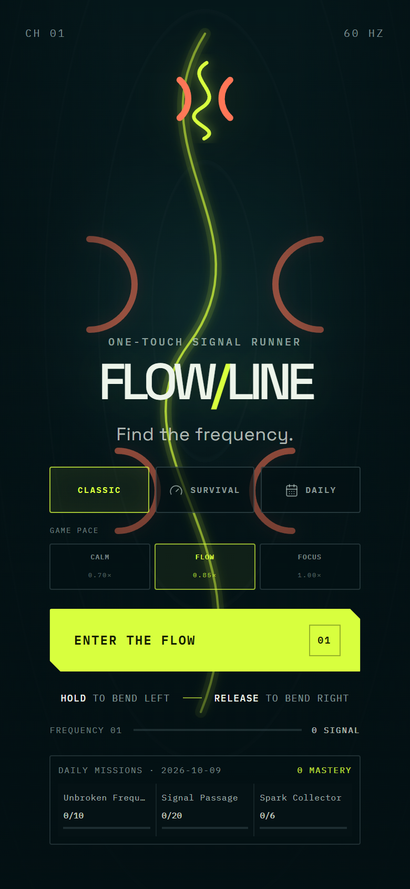

# threshi-art

I build operator-focused software across applied AI, desktop tooling, mobile
prototypes, data systems, games, and computer-science fundamentals.

This profile is the canonical index of the work currently preserved in this
GitHub account. Repository visibility and lifecycle labels below describe the
selected portfolio state as of October 2026; visibility is not a claim of production
readiness. Publication remains bounded by credential, third-party asset,
privacy and reproducible setup reviews.

### Why things look "all private"

1. **Projects tab is not repos.** The profile **Projects** tab shows kanban
   boards. Personal boards default to **Private**. That is normal and separate
   from source visibility. The living
   board is [Project Portfolio Roadmap](https://github.com/users/threshi-art/projects/2)
   (still private as a board).
2. **New repos often start private.** GitHub's default for new personal repos is
   frequently private until you choose otherwise.
3. **Unfinished / sensitive work stays private on purpose** — Nightstalkers,
   Flowline, PearlFuel, FinTelligence, Armada/Horizons tooling, and personal finance material.
4. **Not everything is private.** Public today:
   [Seraphim](https://github.com/threshi-art/Seraphim),
   [infinity-enterprises-site](https://github.com/threshi-art/infinity-enterprises-site),
   and this profile repo.

The table below indexes **repos** (and local-only exceptions), not Project boards.

## Project portfolio

| Project | Status | What exists today | Access |
|---|---|---|---|
| **[Nightstalkers](https://github.com/threshi-art/nightstalkers)** | Active build | Original 2D Thermal Rescue Console helicopter rescue game (React + Babylon.js); Chopper Command | **Private** (unreleased game) |
| **[Seraphim Platform](https://github.com/threshi-art/Seraphim)** | Active build | React/TypeScript command center, Express/tRPC services, a permissioned local bridge, Windows desktop companion work, and reviewed public Skill packages | **Public curated source** |
| **[Flowline](https://github.com/threshi-art/flowline)** | Active, pre-release | Offline-first iOS game target, tested browser prototype, Capacitor/Xcode shell, product documentation, and release planning | **Private** |
| **[PearlFuel Lite](https://github.com/threshi-art/PearlFuel-Web)** | Active prototype | PySide6 dog-meal planning desktop app, optional multi-specialist AI assistant, SwiftUI source, and web experiments | **Private** (`PearlFuel-Web`) |
| **[FinTelligence](https://github.com/threshi-art/FinTelligence)** | Working prototype | Local FastAPI browser app for budgets, portfolio tracking, and retirement projections; an older Flutter prototype is retained | **Private** |
| **[Armada II mod tooling](https://github.com/threshi-art/armada2-mod)** | Audited baseline, active | Reversible PowerShell build/install pipeline, tests, documentation, checksums, and authored patch delta; game assets excluded (formerly `horizons-mod-tooling`) | **Private** |
| **Argus Vigil** | Early MVP (within Seraphim) | Defensive packet-analysis architecture, FastAPI backend shell, and dashboard integration plan | **Not a separate repo** — private within Seraphim |
| **EI-RAM Analysis Studio** | Phase-1 prototype (within Seraphim) | Curated rule-based FastAPI engine, desktop shell, tests, safe sample input, and workbench scaffold; predictive validity remains unvalidated | **Not a separate repo** — private within Seraphim |
| **AEGIS / FinTelligence architecture** | Concept baseline | Fifteen-document product, requirements, design, verification, risk, data, API, and AI-agent architecture package; no live-trading implementation | **Local documentation only** (no dedicated GitHub repo) |
| **[Windows Efficiency Audit](https://github.com/threshi-art/windows-efficiency-audit)** | Archived utility | Read-only PowerShell system-health collector, launcher, local syntax check, privacy guidance, and structured report output | **Private, archived** |

"Active," "prototype," "within Seraphim," and "archived" are deliberately different
labels here. A planning scaffold is not presented as a shipped product, a
satellite module inside Seraphim is not listed as its own repo, and a local
working build is not presented as a public production service.

## Technical range

- TypeScript, React, Express, tRPC, Python, FastAPI, PySide6, Babylon.js
- SwiftUI and Capacitor-based iOS work
- C#, Java, C++, SQL, Flex/Bison, and PowerShell
- Local-first application design, desktop integration, defensive diagnostics,
  structured verification evidence, and release planning

## Repository provenance

Most portfolio repositories were created as curated imports in 2026 from larger
local workspaces. Their first GitHub commits represent portfolio curation dates,
not invented project start dates or reconstructed development history.
Dependencies, build output, archives, employer material, personal financial
files, private research, and known copyrighted game assets are intentionally
excluded from publication.

## Current portfolio work

1. Keep one project = one OneDrive folder = one GitHub repo for active work
   (see local `Programs/REPO_MAP.md`).
2. Reproduce clean installs and verification commands for private prototypes.
3. Reconcile dedicated repositories with historical umbrella snapshots so each
   active project has one canonical source location.
4. Separate additional public-safe showcases from private research, local configuration, employer work, and third-party assets.
5. Publish focused repositories only after project-specific review is complete.

See [PORTFOLIO_INVENTORY.md](PORTFOLIO_INVENTORY.md) for the evidence-based
inventory and current limitations.

## Repository quick reference

**Status:** active.

**What it is:** The public profile index for selected projects.

**How to run:** GitHub renders README.md on the account profile; there is no application runtime.

## Selected highlights

[Seraphim](https://github.com/threshi-art/Seraphim): an operator governed AI platform under active development.

[Infinity Enterprises](https://github.com/threshi-art/infinity-enterprises-site): an independent publication and project portfolio.

**Nightstalkers:** a private helicopter rescue game built with React and Babylon.js. Source remains private; the selected gameplay image is shared here for the portfolio.

**Flowline:** a private offline iPhone signal runner under active development. The screenshot below shows its current browser build in native mode. It is a development preview.

